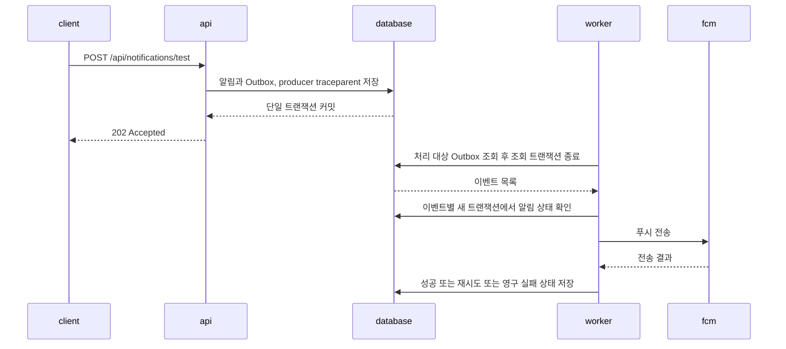

# Beach Complex

**부산 해수욕장 7곳의 시설·혼잡도를 조회하고, 즐겨찾기와 방문 예약을 관리하는 서비스입니다.**

[](https://github.com/Beach-complex/Beach_complex/actions/workflows/ci.yml)
[](#품질과-배포)

Spring Boot 백엔드와 배포·모니터링 설정을 담은 저장소입니다.

[프론트엔드](https://github.com/Beach-complex/beach_complex_client) · [주요 구현](#주요-구현) · [문제 해결](#문제-해결) · [로컬 실행](#로컬-실행) · [문서](#문서)

## 기술 스택


| 영역 | 기술 |
| --- | --- |
| 프론트엔드 | React (별도 저장소) |
| 백엔드 | Java 21, Gradle, Spring Boot 3.3, Spring Security, JWT, Spring Data JPA / Hibernate |
| 데이터베이스·캐시 | PostgreSQL 16 / PostGIS 3.4, Flyway, Caffeine, Redis 7 (로컬 개발용) |
| 외부 연동 | Firebase Cloud Messaging(FCM), AWS Lambda Function URL / SigV4, Spring Mail / Gmail SMTP |
| 메트릭·로그·Trace 계측 | Spring Boot Actuator, Micrometer, OpenTelemetry, Logback |
| 모니터링 | Prometheus, node_exporter, Grafana Alloy, Loki, Tempo, Grafana |
| 인프라 | AWS EC2, EBS, Security Group, IAM role, Docker / Docker Compose, Terraform, cloud-init |
| CI/CD | GitHub Actions, GitHub Container Registry(GHCR), SSH 배포 |
| 품질 | JUnit 5, Testcontainers, JaCoCo, Checkstyle, Spotless, Gitleaks |

## 시스템 구성

[](./assets/images/system-architecture.png)

앱 서버는 Spring Boot와 PostgreSQL/PostGIS를 Docker Compose로 실행합니다. React 클라이언트는 REST API를 호출하고, 백엔드는 혼잡도 조회에 AWS Lambda, 이메일 인증에 Gmail SMTP, 푸시 알림에 FCM을 사용합니다.

모니터링은 별도 EC2에 Prometheus·Tempo·Loki·Grafana를 두는 구성입니다. 앱의 Trace는 Tempo로, Alloy가 수집한 Docker 로그는 Loki로 보냅니다. Grafana에서 메트릭, 로그, Trace를 조회합니다.

## 주요 구현

### 반경 검색과 조회 캐시

위도·경도와 반경을 입력하면 가까운 해수욕장부터 반환합니다. PostGIS의 `ST_DWithin`으로 검색 범위를 제한하고 `ST_Distance`로 정렬합니다. 반경은 API에서 km로 받아 DB 조회 시 m로 변환합니다.

시설·상태 조회에는 Caffeine 캐시를 적용했습니다. 기존 메모리 맵에 만료 시간과 크기 제한이 없어 교체했으며, 별도 서버가 필요 없는 로컬 캐시를 선택했습니다. TTL은 10분, 캐시별 최대 항목은 1,000개입니다.

[공간 쿼리](./src/main/java/com/beachcheck/beach/repository/BeachRepository.java) · [조회 API 통합 테스트](./src/test/java/com/beachcheck/beach/integration/BeachControllerIntegrationTest.java) · [Caffeine 선택 배경과 대안](https://github.com/Beach-complex/beach_complex_docs/blob/main/adr/001-cache-migration-caffeine.md)

### Outbox 기반 푸시 알림

알림과 전송할 이벤트를 하나의 DB 트랜잭션으로 저장합니다. API는 저장 직후 응답하고, 워커가 이벤트를 읽어 FCM으로 푸시를 보냅니다. 전송 결과와 재시도할 작업을 DB에 남겨 별도 메시지 브로커 없이 처리합니다.

테스트 푸시 API의 처리 흐름은 다음과 같습니다.



워커는 전송을 시도할 때마다 새 Trace를 만들고, 이벤트에 저장된 `traceparent`를 Span Link로 연결합니다. 이를 통해 재시도한 작업에서도 최초 요청을 찾을 수 있습니다. FCM 전송 후 DB 커밋에 실패하면 같은 알림이 다시 전송될 수 있습니다.

[Outbox 설계와 대안](https://github.com/Beach-complex/beach_complex_docs/blob/main/adr/ADR-008-outbox-rdb-task-queue.md) · [전송·재시도 테스트](./src/test/java/com/beachcheck/outbox/service/OutboxEventDispatcherTest.java) · [Trace 연결 테스트](./src/test/java/com/beachcheck/outbox/tracing/OutboxTracingIntegrationTest.java)

### 로그와 Trace 조회

Grafana에서 로그의 `traceId`를 누르면 해당 요청의 Trace를 볼 수 있습니다. Trace에서도 같은 요청의 로그를 조회할 수 있도록 Loki와 Tempo 데이터소스를 연결했습니다.

로그 수집은 Alloy가 맡습니다. 앱이 표준 출력으로 남긴 로그를 Docker 파일에서 읽어 Loki로 보내므로, 앱에 로그 전송 코드를 넣거나 Docker socket을 열 필요가 없습니다. 로그 파일의 회전 한도를 넘기거나 저장 볼륨에 장애가 생기면 로그가 유실될 수 있습니다.

JWT·FCM 토큰·SQL 바인딩 값은 Trace에 기록하지 않습니다. `traceId`는 로그 본문에만 남기고 Loki 인덱스 라벨에서는 제외했습니다.

[Loki 선택 배경](https://github.com/Beach-complex/beach_complex_docs/blob/main/adr/ADR-014-logging-storage-backend.md) · [Alloy 선택 배경](https://github.com/Beach-complex/beach_complex_docs/blob/main/adr/ADR-015-log-collector.md) · [Trace 수집 계약](./docs/TRACING_CONTRACT.md)

## 문제 해결

### Outbox 트랜잭션 간 잠금 충돌

폴링 트랜잭션이 잡은 행 잠금 때문에 전송 트랜잭션의 갱신이 멈추는 문제가 있었습니다. 폴링 루프에 `NOT_SUPPORTED`를 적용하고, 조회 트랜잭션이 끝난 뒤 이벤트별 전송 트랜잭션을 시작하도록 바꿨습니다. 조회 메서드의 read-only 설정과 쓰기 잠금이 충돌하는 문제도 함께 수정했습니다.

통합 테스트에서는 준비 데이터를 먼저 커밋한 뒤 전송과 상태 변경을 확인합니다. 이미 전송한 알림을 건너뛰는 경우도 검사합니다.

[재현·원인·수정 기록](https://github.com/Beach-complex/beach_complex_docs/blob/main/backend/troubleshooting/outbox-integration-requires-new-lock-readOnly-deadlock.md) · [통합 테스트](./src/test/java/com/beachcheck/outbox/integration/OutboxPublisherIntegrationTest.java)

### Docker 로그 분할·회전 처리

긴 JSON 로그가 여러 Docker 레코드로 나뉘고, Alloy가 멈춘 동안 로그 파일이 회전하면서 일부 기록이 누락되는 문제가 있었습니다.

Alloy가 컨테이너와 출력 스트림별로 로그 조각을 합치도록 수정했습니다. 파일 지문과 읽기 위치도 저장해 재시작 후 이어 읽습니다. CI에서는 출력이 섞인 40KB JSON, 수집 중지 중 회전한 로그 110건, 파일 경계를 넘은 90KB JSON이 원문대로 복구되는지 확인합니다.

[CI 검증 결과](./assets/reports/log-pipeline-20261001.json) · [검증 스크립트](./deploy/observability/scripts/verify-log-pipeline.py) · [운영 제약](./deploy/observability/README.md#운영-제약)

그 밖의 기록: [Docker Engine과 Testcontainers의 API 버전 불일치 해결](https://github.com/Beach-complex/beach_complex_docs/blob/main/backend/troubleshooting/troubleshooting-testcontainers-docker-api-version-400.md)

## 품질과 배포

`main`·`develop` 대상 PR과 push에서 [CI](./.github/workflows/ci.yml)를 실행합니다.

| 검증 대상 | 검사 내용 |
| --- | --- |
| 백엔드 | UTF-8, 컴파일·Checkstyle·Spotless, 단위·통합 테스트, 빌드, JaCoCo |
| 관측 환경 | Terraform·cloud-init·Compose 설정, 합성 로그·Trace 전송, 회전·재시작·Loki 장애 복구 |

DB 쿼리와 API 테스트는 Testcontainers의 PostgreSQL/PostGIS에서 실행합니다. Trace 테스트에서는 [SQL 바인딩 값이 수집되지 않는지](./src/test/java/com/beachcheck/global/tracing/JdbcTracingIntegrationTest.java), [외부 호출까지 Trace가 이어지는지](./src/test/java/com/beachcheck/external/congestion/CongestionClientTracingIntegrationTest.java) 검사합니다.

커버리지 배지는 2026-10-01 커밋 `af6dceda` 기준이며 자동 갱신되지 않습니다. 라인 커버리지는 89.8% (1,617 / 1,801)입니다. [CI 결과](https://github.com/Beach-complex/Beach_complex/actions/runs/36867196523) · [JaCoCo 보고서](./assets/reports/jacoco-20261001.xml)

관측 스택은 [Prometheus·Tempo·Grafana의 EC2 실행과 연동](https://github.com/Beach-complex/Beach_complex/pull/238)을 확인했습니다. [Loki·Alloy 로그 파이프라인](https://github.com/Beach-complex/Beach_complex/pull/264)은 로컬 Docker에서 합성 로그와 Trace로 테스트했습니다.

- **비밀정보 검사:** 설치한 로컬 [Git 훅](./.githooks/pre-commit)이 [Gitleaks](./scripts/secret-scan.sh)로 스테이징된 추가 줄을 검사합니다.
- **배포:** `main`의 백엔드 관련 파일이 바뀌면 이미지를 빌드해 GHCR에 올리고, SSH로 EC2의 Compose 서비스를 갱신합니다. [CD 수동 실행](./.github/workflows/backend-cd.yml)도 지원합니다.

## 로컬 실행

JDK 21, Docker Compose, Git, OpenSSL이 필요합니다. 아래 Bash 명령은 이메일·푸시 발송을 끈 상태로 API를 실행합니다.

```bash
git clone https://github.com/Beach-complex/Beach_complex.git
cd Beach_complex
docker compose up -d --wait postgres redis

export SPRING_PROFILES_ACTIVE=dev
export APP_FIREBASE_ENABLED=false
export APP_OUTBOX_POLLING_ENABLED=false
export APP_MAIL_ENABLED=false
export MANAGEMENT_HEALTH_MAIL_ENABLED=false
export CONGESTION_SIGV4_ENABLED=false
export JWT_SECRET=$(openssl rand -hex 32)

./gradlew bootRun
```

DB 마이그레이션과 초기 데이터 입력은 앱 시작 시 Flyway가 처리합니다. 외부 혼잡도 API를 연결하지 않으면 30분마다 실행되는 갱신 작업에서 연결 실패 로그가 남을 수 있습니다.

[Swagger UI](http://localhost:8080/swagger-ui.html) · [Health](http://localhost:8081/actuator/health)

```bash
# 해운대 좌표 기준 반경 5km 검색
curl 'http://localhost:8080/api/beaches?lat=35.1587&lon=129.1599&radiusKm=5'

# Docker 실행 상태에서 테스트·빌드·커버리지 확인
./gradlew test assemble jacocoTestReport
```

PowerShell 실행 방법, JWT 키 변경 시 주의사항, Redis 실행 이유와 외부 서비스 설정은 [로컬 개발 가이드](./docs/LOCAL_DEVELOPMENT.md)를 참고하세요.

## 프로젝트 구조

```text
Beach_complex/
├── src/main/java/com/beachcheck/
│   ├── auth/            # JWT, 이메일 인증·발송
│   ├── beach/           # 검색, 시설·상태, 혼잡도 갱신 스케줄러
│   ├── external/        # 혼잡도 API, AWS SigV4
│   ├── global/          # 보안, 캐시, 예외, 로그·Trace 설정
│   ├── notification/    # 알림 생성·설정
│   ├── outbox/          # 이벤트 저장·폴링·FCM 전송
│   ├── reservation/     # 방문 예약
│   └── user/            # 사용자, 즐겨찾기
├── src/main/resources/
│   ├── db/migration/    # Flyway 마이그레이션
│   └── application*.yml
├── src/test/            # 단위·통합 테스트, 공통 fixture
├── deploy/
│   └── observability/   # Terraform, Compose, 관측 파이프라인 검증
├── docs/               # 로컬 개발 가이드, Trace 공통 계약
├── assets/             # README 구성도·CI 검증 기록
├── .github/workflows/   # CI, 컨테이너 빌드·배포
└── docker-compose.yml   # 로컬 PostgreSQL/PostGIS, Redis
```

## 문서

이 저장소에는 공개용 개발 가이드와 일부 기술 문서를 두고 있습니다. 상세 설계와 내부 협업·운영 기록은 비공개 문서 저장소에서 관리합니다. 본문에 연결된 ADR과 문제 해결 기록도 해당 저장소의 접근 권한이 필요합니다.

- [로컬 개발 가이드](./docs/LOCAL_DEVELOPMENT.md)
- [문서 저장소 · 비공개](https://github.com/Beach-complex/beach_complex_docs) · [ADR 목록 · 비공개](https://github.com/Beach-complex/beach_complex_docs/tree/main/adr)
- [문제 해결 기록 · 비공개](https://github.com/Beach-complex/beach_complex_docs/tree/main/backend/troubleshooting)
- [관측 환경 가이드](./deploy/observability/README.md) · [Trace 공통 계약](./docs/TRACING_CONTRACT.md)
- [프론트엔드](https://github.com/Beach-complex/beach_complex_client)

## 팀 & 역할

| 역할 | 이름 | GitHub |
| --- | --- | --- |
| Backend / Infra | 박재홍 | [@PHJ2000](https://github.com/PHJ2000) |
| Backend | 박건우 | [@geonusp](https://github.com/geonusp) |
| Frontend / PM | 정도경 | [@DoGyeong888](https://github.com/DoGyeong888) |

## 라이선스

[MIT License](./LICENSE)
