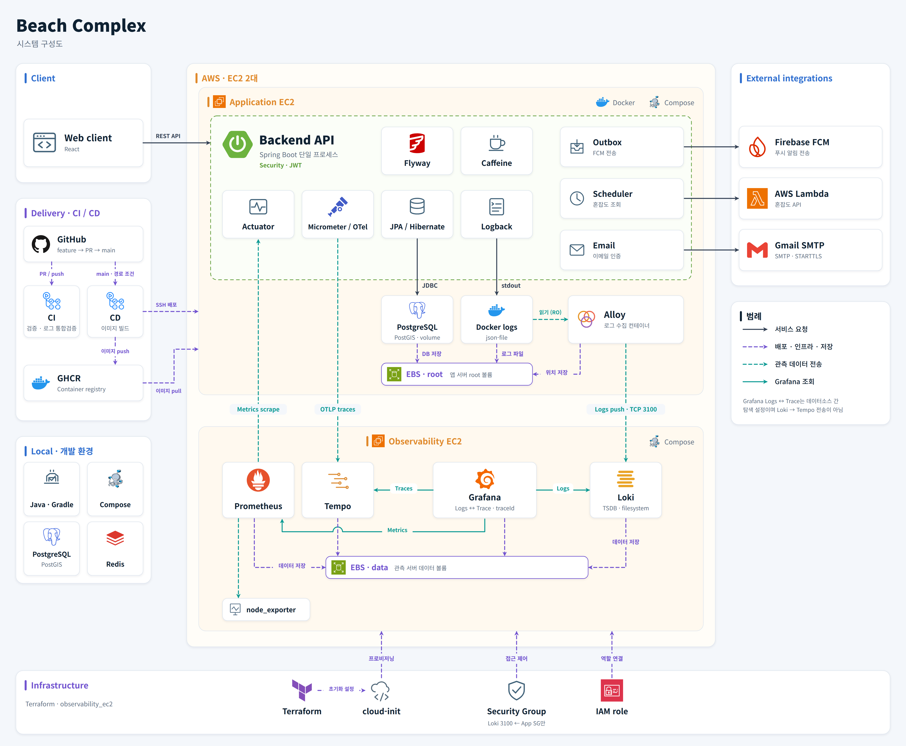
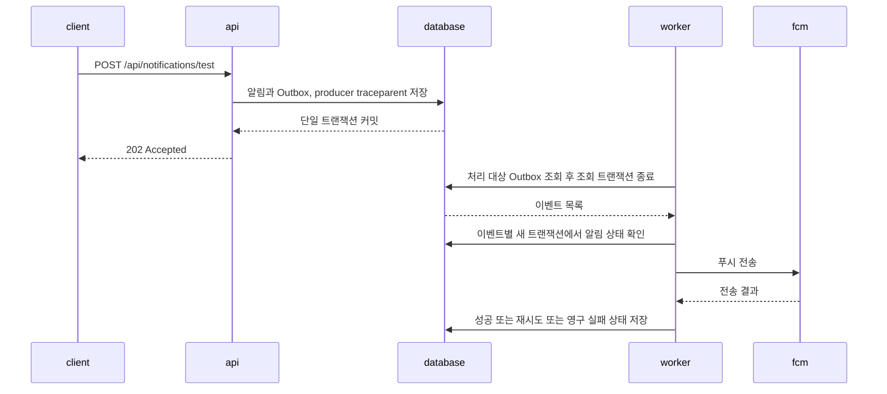

# Beach Complex

**주변 해수욕장의 시설과 혼잡도를 확인하고 방문을 예약하는 서비스입니다.**

[](https://github.com/Beach-complex/Beach_complex/actions/workflows/ci.yml)
[](#품질과-배포)

부산 해수욕장 7곳을 시작으로, 위치 기반 검색과 시설·상태 조회, 즐겨찾기, 방문 예약을 제공합니다. 이 저장소는 Spring Boot 백엔드와 배포·관측 환경을 관리합니다.

[프론트엔드](https://github.com/Beach-complex/beach_complex_client) · [주요 구현](#주요-구현) · [문제 해결](#문제-해결) · [로컬 실행](#로컬-실행) · [문서](#문서)

## 기술 스택


| 영역 | 기술 |
| --- | --- |
| 프론트엔드 · 별도 저장소 | React |
| 백엔드 | Java 21, Gradle, Spring Boot 3.3, Spring Security, JWT, Spring Data JPA / Hibernate |
| 데이터 · 캐시 | PostgreSQL 16 / PostGIS 3.4, Flyway, Caffeine · Redis 7은 로컬 개발 Compose에 포함 |
| 외부 연동 | Firebase Cloud Messaging(FCM), AWS Lambda Function URL / SigV4, Spring Mail / Gmail SMTP |
| 관측 · 앱 계측 | Spring Boot Actuator, Micrometer, OpenTelemetry, Logback |
| 관측 · 수집과 저장 | Prometheus, node_exporter, Grafana Alloy, Loki, Tempo, Grafana |
| 인프라 | AWS EC2, EBS, Security Group, IAM role, Docker / Docker Compose, Terraform, cloud-init |
| CI/CD | GitHub Actions, GitHub Container Registry(GHCR), SSH 배포 |
| 품질 | JUnit 5, Testcontainers, JaCoCo, Checkstyle, Spotless, Gitleaks |

## 시스템 구성

[](./assets/images/system-architecture.png)

앱 EC2에서 Spring Boot와 PostgreSQL/PostGIS를 실행합니다. React가 REST API를 호출하며, 혼잡도는 Lambda Function URL(SigV4), 이메일 인증은 Gmail SMTP, 푸시는 FCM과 연동합니다.

관측 EC2에는 Prometheus·Tempo·Loki·Grafana를 배치했습니다. Prometheus가 앱과 호스트의 메트릭을 수집하고, 앱은 Trace를 Tempo로 보냅니다. Alloy가 Docker 로그를 읽어 Loki로 전송하며, Grafana에서 `traceId`로 로그와 Trace를 오가며 확인합니다.

## 주요 구현

### 위치로 찾고, 시설과 상태를 확인하는 조회 API

위도·경도와 반경을 받으면 PostGIS의 `ST_DWithin`으로 범위 안의 해수욕장을 찾고 `ST_Distance`로 가까운 순서대로 반환합니다. API의 반경 단위는 km이며, DB 조회 시 m로 변환합니다.

시설·상태 등 반복 조회에는 Caffeine 캐시를 사용합니다. 기존 메모리 맵에 없던 만료·크기 제한을 적용하면서 별도 캐시 서버 없이 운영하기 위해 선택했습니다. TTL은 10분, 캐시별 최대 항목은 1,000개이며 인스턴스 간 캐시는 공유하지 않습니다.

[공간 쿼리](./src/main/java/com/beachcheck/beach/repository/BeachRepository.java) · [조회 API 통합 테스트](./src/test/java/com/beachcheck/beach/integration/BeachControllerIntegrationTest.java) · [Caffeine 선택 배경과 대안](https://github.com/Beach-complex/beach_complex_docs/blob/main/adr/001-cache-migration-caffeine.md)

### 알림 저장과 푸시 전송을 분리한 Outbox

알림과 전송 이벤트를 같은 DB 트랜잭션에 저장합니다. 워커가 이벤트를 읽어 FCM으로 전송하고 성공·재시도·영구 실패 상태를 기록합니다. 메모리 큐 대신 DB에 작업을 남기고, 추가 메시지 브로커 없이 전송 상태를 관리하는 구조입니다.

테스트 푸시 API를 호출했을 때의 흐름입니다.



API는 저장 후 `202 Accepted`를 반환하며 FCM 응답을 기다리지 않습니다. 전송 시도마다 독립된 consumer Trace를 만들고, 저장된 `traceparent`를 Span Link로 연결해 최초 요청까지 추적합니다. FCM 전송과 DB 커밋 사이에 실패하면 중복 전송이 발생할 수 있습니다.

[Outbox 설계와 대안](https://github.com/Beach-complex/beach_complex_docs/blob/main/adr/ADR-008-outbox-rdb-task-queue.md) · [전송·재시도 테스트](./src/test/java/com/beachcheck/outbox/service/OutboxEventDispatcherTest.java) · [Trace 연결 테스트](./src/test/java/com/beachcheck/outbox/tracing/OutboxTracingIntegrationTest.java)

### 로그에서 요청의 Trace까지 연결

Grafana에서 로그의 `traceId`로 Tempo의 Trace를 열고, Trace에서도 관련 로그를 조회합니다. 로그는 Loki, Trace는 Tempo에 각각 저장하며 Grafana가 두 데이터소스를 연결합니다.

로그 저장소는 식별자 중심 조회와 운영 구성을 고려해 Loki를 선택했습니다. Alloy는 Docker 로그 파일을 읽어 전송하므로 앱 요청 경로에서 Loki로 직접 전송하지 않고, Docker socket 접근도 필요하지 않습니다. 대신 파일 경로·권한·회전 정책에 의존하고, 단일 저장 볼륨 장애나 장시간 수집 중단 시 로그를 잃을 수 있습니다.

JWT·FCM 토큰·SQL 바인딩 값 등은 Trace 수집 대상에서 제외합니다. `traceId`는 로그에 남기되 Loki 인덱스 라벨로 사용하지 않습니다.

[Loki 선택 배경](https://github.com/Beach-complex/beach_complex_docs/blob/main/adr/ADR-014-logging-storage-backend.md) · [Alloy 선택 배경](https://github.com/Beach-complex/beach_complex_docs/blob/main/adr/ADR-015-log-collector.md) · [Trace 수집 계약](./docs/TRACING_CONTRACT.md)

## 문제 해결

### Outbox 조회와 전송 트랜잭션의 잠금 충돌

폴링 트랜잭션이 조회한 행의 잠금을 유지한 채, 별도 전송 트랜잭션이 같은 행을 갱신하기를 기다리고 있었습니다. 폴링 루프를 `NOT_SUPPORTED`로 바꾸고 조회와 개별 전송의 트랜잭션을 분리했습니다. 이 과정에서 드러난 조회의 read-only 설정과 쓰기 잠금 충돌도 수정했습니다.

통합 테스트에서는 별도 트랜잭션에서 준비 데이터를 읽을 수 있도록 먼저 커밋했습니다. 이후 이벤트 전송·상태 갱신과 이미 전송된 알림을 건너뛰는 동작을 확인했습니다.

[재현·원인·수정 기록](https://github.com/Beach-complex/beach_complex_docs/blob/main/backend/troubleshooting/outbox-integration-requires-new-lock-readOnly-deadlock.md) · [통합 테스트](./src/test/java/com/beachcheck/outbox/integration/OutboxPublisherIntegrationTest.java)

### 로그가 나뉘고 파일이 회전해도 원문 복구

긴 앱 로그는 여러 Docker 레코드로 나뉩니다. 수집기가 중지된 동안 파일까지 회전하면 단순히 행을 읽거나 마지막 파일명만 기억하는 방식으로 원문을 복구하기 어렵습니다.

Alloy에서 컨테이너·stdout/stderr별로 조각을 재조립하고, 파일 지문과 읽기 위치를 저장해 재시작 후 이어 읽도록 구성했습니다. 합성 데이터 CI에서 **교차 출력된 40KB JSON**, **수집 중지 중 회전된 로그 110건**, **파일 경계를 넘은 90KB JSON**의 복구를 확인했습니다.

[CI 검증 결과](./assets/reports/log-pipeline-20261001.json) · [검증 스크립트](./deploy/observability/scripts/verify-log-pipeline.py) · [운영 제약](./deploy/observability/README.md#운영-제약)

그 밖의 기록: [Docker Engine과 Testcontainers의 API 버전 불일치 해결](https://github.com/Beach-complex/beach_complex_docs/blob/main/backend/troubleshooting/troubleshooting-testcontainers-docker-api-version-400.md)

## 품질과 배포

`main`·`develop` 대상 PR과 push에서 [CI](./.github/workflows/ci.yml)를 실행합니다.

| 검증 대상 | 검사 내용 |
| --- | --- |
| 백엔드 | UTF-8, 컴파일·Checkstyle·Spotless, 단위·통합 테스트, 빌드, JaCoCo |
| 관측 환경 | Terraform·cloud-init·Compose 설정, 합성 로그·Trace 전송, 회전·재시작·Loki 장애 복구 |

단위 테스트로 입력 검증과 알림 상태 전이를 확인하고, Testcontainers의 PostgreSQL/PostGIS로 DB 쿼리와 API 응답을 검증합니다. Trace 계약 테스트는 [JDBC 바인딩 값 제외](./src/test/java/com/beachcheck/global/tracing/JdbcTracingIntegrationTest.java)와 [외부 호출의 Trace 연결](./src/test/java/com/beachcheck/external/congestion/CongestionClientTracingIntegrationTest.java)을 확인합니다.

커버리지 배지는 **2026-10-01 · `af6dceda`** CI의 고정 스냅샷입니다. 라인 **1,617 / 1,801 = 89.8%**이며 [CI 실행](https://github.com/Beach-complex/Beach_complex/actions/runs/36867196523)과 [JaCoCo 원본](./assets/reports/jacoco-20261001.xml)을 연결했습니다.

- **비밀정보 검사:** 설치한 로컬 [Git 훅](./.githooks/pre-commit)이 [Gitleaks](./scripts/secret-scan.sh)로 스테이징된 추가 줄을 검사합니다.
- **배포:** `main`의 백엔드 관련 경로 변경 또는 [CD 수동 실행](./.github/workflows/backend-cd.yml) → 이미지 빌드 → GHCR push → SSH로 EC2 Compose 서비스 갱신.

## 로컬 실행

JDK 21, Docker Compose, Git이 필요합니다. 아래는 이메일·푸시 발송을 끄고 API를 실행하는 Bash 예시이며, JWT 키 생성에 OpenSSL을 사용합니다.

```bash
git clone https://github.com/Beach-complex/Beach_complex.git
cd Beach_complex
docker compose up -d --wait postgres redis

export SPRING_PROFILES_ACTIVE=dev
export APP_FIREBASE_ENABLED=false
export APP_OUTBOX_POLLING_ENABLED=false
export APP_MAIL_ENABLED=false
export MANAGEMENT_HEALTH_MAIL_ENABLED=false
export CONGESTION_SIGV4_ENABLED=false
export JWT_SECRET=$(openssl rand -hex 32)

./gradlew bootRun
```

Flyway가 초기 데이터를 적용합니다. JWT 키 생성 명령을 다시 실행하면 기존 토큰은 유효하지 않게 됩니다. 혼잡도 스케줄러는 계속 동작하므로 외부 API를 연결하지 않으면 30분 주기 갱신 시 연결 실패 로그가 발생할 수 있습니다.

API 캐시는 Caffeine을 사용하며, Redis는 기본 Actuator Health 점검 때문에 함께 실행합니다.

[Swagger UI](http://localhost:8080/swagger-ui.html) · [Health](http://localhost:8081/actuator/health)

```bash
# 해운대 좌표 기준 반경 5km 검색
curl 'http://localhost:8080/api/beaches?lat=35.1587&lon=129.1599&radiusKm=5'

# Docker 실행 상태에서 테스트·빌드·커버리지 확인
./gradlew test assemble jacocoTestReport
```

[로컬 개발 가이드](./docs/LOCAL_DEVELOPMENT.md)에 PowerShell 실행, DB 접속 정보, 외부 서비스 환경변수, API 목록과 Git 훅 설치 방법을 정리했습니다.

## 프로젝트 구조

```text
Beach_complex/
├── src/main/java/com/beachcheck/
│   ├── auth/            # JWT, 이메일 인증·발송
│   ├── beach/           # 검색, 시설·상태, 혼잡도 갱신 스케줄러
│   ├── external/        # 혼잡도 API, AWS SigV4
│   ├── global/          # 보안, 캐시, 예외, 로그·Trace 설정
│   ├── notification/    # 알림 생성·설정
│   ├── outbox/          # 이벤트 저장·폴링·FCM 전송
│   ├── reservation/     # 방문 예약
│   └── user/            # 사용자, 즐겨찾기
├── src/main/resources/
│   ├── db/migration/    # Flyway 마이그레이션
│   └── application*.yml
├── src/test/            # 단위·통합 테스트, 공통 fixture
├── deploy/
│   └── observability/   # Terraform, Compose, 관측 파이프라인 검증
├── docs/               # 로컬 개발 가이드, Trace 공통 계약
├── assets/             # README 구성도·CI 검증 기록
├── .github/workflows/   # CI, 컨테이너 빌드·배포
└── docker-compose.yml   # 로컬 PostgreSQL/PostGIS, Redis
```

## 문서

외부에 공개 가능한 일부 문서만 이 저장소에 남겨두었습니다. 상세 설계·ADR·문제 해결 기록과 내부 협업·운영 문서는 비공개 [문서 저장소](https://github.com/Beach-complex/beach_complex_docs)에서 관리합니다. 아래와 본문의 문서 저장소 링크는 접근 권한이 필요하며, 권한이 없는 경우 GitHub에서 404로 표시될 수 있습니다.

- [로컬 개발 가이드](./docs/LOCAL_DEVELOPMENT.md)
- [문서 저장소 · 비공개](https://github.com/Beach-complex/beach_complex_docs) · [ADR 목록 · 비공개](https://github.com/Beach-complex/beach_complex_docs/tree/main/adr)
- [문제 해결 기록 · 비공개](https://github.com/Beach-complex/beach_complex_docs/tree/main/backend/troubleshooting)
- [관측 환경 가이드](./deploy/observability/README.md) · [Trace 공통 계약](./docs/TRACING_CONTRACT.md)
- [프론트엔드](https://github.com/Beach-complex/beach_complex_client)

## 팀 & 역할

| 역할 | 이름 | GitHub |
| --- | --- | --- |
| Backend / Infra | 박재홍 | [@PHJ2000](https://github.com/PHJ2000) |
| Backend | 박건우 | [@geonusp](https://github.com/geonusp) |
| Frontend / PM | 정도경 | [@DoGyeong888](https://github.com/DoGyeong888) |

## 라이선스

[MIT License](./LICENSE)
